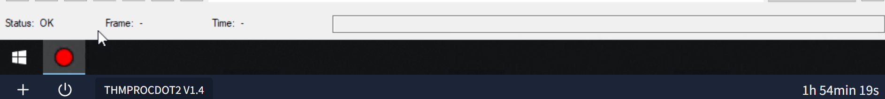

# Dunkle_Materie_ProcDOT_Investigation_Writeup

# Dunkle Materie

### Investigating a Ransomware Attack Using ProcDOT

**Room:** TryHackMe — Dunkle Materie

## Scenario

The firewall alerted the Security Operations Center that one of the machines in the Sales department — which stores all the customers’ data — contacted malicious domains over the network. When Security Analysts looked closely, the data sent to the domains contained suspicious Base64-encoded strings. The Analysts involved the Incident Response team in pulling the Process Monitor and network traffic data to determine if the host was infected. But once they got on the machine, they knew it was a ransomware attack just by looking at the wallpaper and reading the ransomware note.

**Task:** Find more evidence of compromise on the host and identify the ransomware involved.

## Tooling: ProcDOT

In this room, the lab machine requires the tool **ProcDOT**:

> A free visual malware-analysis tool that merges Sysinternals Process Monitor (Procmon) logs with PCAP network captures to create an interactive behavioral graph of system activity. Created by Christian Wojner of CERT.at, using Graphviz DOT format to visualize processes, files, registry actions, and network events.
> 

ProcDOT is opened using the red button in the tool, and then the Procmon log file (`Logfile.CSV`) and the network capture (`traffic.pcap`) are provided from the Desktop → Analysis Files folder. Once given, ProcDOT starts analyzing the files.



---


## Q1: Provide the two PIDs spawned from the malicious executable (in the order they appear in the analysis tool).

I got a list of the processes and their PIDs. I found this by looking at the spelling of “explorer.” It’s trying to masquerade as `explorer.exe`, but is actually spelled `exploreer.exe`. Its first PID was **8644**. On scrolling down, I also found another PID for it: **7128**.


---

## Q2: Provide the full path where the ransomware initially got executed (include the full path).

For this, I double-clicked on the first, masqueraded `exploreer.exe` process. This process then automatically got selected in the Launcher field.

I clicked the  **Refresh** button to generate its interactive graph. This took a few minutes and generated a new graph.

On clicking the nodes on the graph, I got this file path:


```
FILE:c:\users\sales\appdata\local\temp\exploreer.exe
```

---

## Q3: This ransomware transfers compromised system info and encryption results to two domains over HTTP POST. What are the two C2 domains?

For this, I went to the second process ID of `exploreer.exe` and generated its graph again, by double-clicking that process and clicking Refresh, which produced a new graph for that process.

The graph showed `explorer.exe` (PID: 7128) connecting to three domains, meaning it sent data to three separate domains:

1. `cisco.com`
2. `mojobiden.com`
3. `paymenthacks.com`


Their IPs are shown below each domain name in the graph. Of these three, `cisco.com` is a legitimate domain the process reached (associated with Cisco Umbrella, see Q6) 

---

## Q4: What are the IPs of the malicious domains?

Already found alongside the domain names in the graph from Q3.

---

## Q5: Provide the user-agent used to transfer the encrypted data to the C2 channel.

To find the user-agent used, I right-clicked the first malicious domain node and selected **Follow TCP Stream**. This revealed the full HTTP POST request:


---

## Q6: Provide the cloud security service that blocked the malicious domain.

In the TCP stream window above, I can see the traces that the data was being passed through — the Server header shows the traffic went through **Cisco Umbrella**, which is a cloud security service.

**Answer:** `Cisco Umbrella`

---

## Q7: Provide the name of the bitmap that the ransomware set up as a desktop wallpaper.

Looking at thread **4892**, created by `explorer.exe` (PID: 7128), I can see that it set values at the registry location `HKCU\Control Panel\Desktop\Wallpaper`. To view these values, I right-clicked on the registry location node in the graph, then in the `data` field, clicked **View**. This surfaced the registry keys:


---

## Q8: Find the PID of the process which attempted to change the background wallpaper.

Already identified in Q7 — the thread (4892) belongs to `explorer.exe`.

---

## Q9: The ransomware mounted a drive and assigned it a letter. Provide the registry key path to the mounted drive, including the drive letter.

To find this, I followed the registry keys related to thread 4892 in the graph. One registry key name was:

```
HKLM\SYSTEM\MountedDevices\DosDevice\Z
```

To view more details, I right-clicked it and selected **More Details** — or, more simply, the drive letter assigned is readable directly from the registry path itself: `Z`.

**Answer:** `HKLM\SYSTEM\MountedDevices\DosDevice\Z`

---

## Q10: Provide the name of the ransomware used in the attack (external research required).

By this point, the collected IOCs were:

- Malicious process: `exploreer.exe`
- Thread created by this malicious process: `4892`
- This thread accessed a registry path to change the desktop wallpaper background (`ley9kpi9r.bmp`)
- It mounted a drive and assigned it the letter `Z`, via the registry path `HKLM\SYSTEM\MountedDevices\DosDevice\Z`
- The malicious process connected to two malicious domains: `mojobiden.com` and `paymenthacks.com`, with IPs `146.112.61.108` and `206.188.197.206`

I used VirusTotal to scan these two malicious domains for additional context. The community/IOC results returned:

> **tines_bot** (5 years ago): “This IOC was found in a paste: `https://pastebin.com/FHajhi8R` with the title ‘BlackMatter Ransom Config (Chile)’ by 1ZRR4H.”
> 

This directly ties the infrastructure (`mojobiden.com` / `paymenthacks.com`) to a known **BlackMatter** ransomware configuration paste.

**Answer:** `BlackMatter`

---

## Summary

| # | Finding |
| --- | --- |
| Masquerading malicious process | `exploreer.exe` (PIDs `8644`, `7128`) |
| Execution path | `c:\users\sales\appdata\local\temp\exploreer.exe` |
| C2 domains | `mojobiden.com` (146.112.61.108), `paymenthacks.com` (206.188.197.206) |
| Exfiltration user-agent | `Firefox/89.0` |
| Security control observed in traffic | Cisco Umbrella (blocked/logged traffic) |
| Ransom wallpaper file | `ley9kpi9r.bmp` |
| Wallpaper-setting process | `explorer.exe` (PID 7128, thread 4892) |
| Mounted drive registry path | `HKLM\SYSTEM\MountedDevices\DosDevice\Z` (drive letter `Z`) |
| Ransomware family identified | BlackMatter |

**Verdict:** Confirmed BlackMatter ransomware infection — a disguised `exploreer.exe` process executed from a user’s temp directory, exfiltrated system/encryption data over HTTP POST to two C2 domains (partially passing through Cisco Umbrella), mounted an additional drive for encryption staging, and deployed the classic ransom-note desktop wallpaper technique to notify the victim.