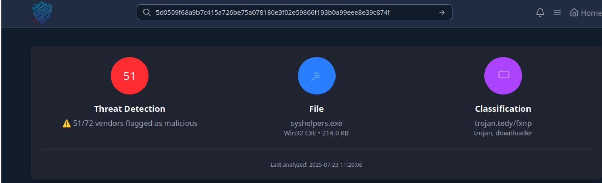

# Invite_Only

# Invite Only

## Scenario

As an SOC analyst on the SOC team at Managed Server Provider **TrySecureMe**, I’m supporting an L3 analyst in investigating flagged IPs, hashes, URLs, or domains as part of IR activities. One of the L1 analysts flagged two suspicious findings early in the morning and escalated them:

- **Flagged IP:** `101[.]99[.]76[.]120`
- **Flagged SHA256 hash:** `5d0509f68a9b7c415a726be75a078180e3f02e59866f193b0a99eee8e39c874f`

The task: analyze these findings further and distil the information into usable threat intelligence, using a newly purchased threat intel search application, **TryDetectThis2.0**.

---

## Q1: What is the name of the file identified with the flagged SHA256 hash?

For this, I used the given SHA256 hash and pasted it into TryDetectThis2.0. Got the file name: `syshelpers.exe`.



**Answer:** `syshelpers.exe`

---

## Q2: What is the file type associated with the flagged SHA256 hash?

I also got the file type listed below the file name.

**Answer:** `Windows Win32 EXE`

---

## Q3: What are the execution parents of the flagged hash? (chronological, comma-separated)

In the **Relations** tab, I found this:


The execution parents of the flagged hash are `361GjX7j` and `installer.exe`.

**Answer:** `361GjX7j, installer.exe`

*(Hashes noted for later use: `361GjX7j` → `047c5eec0445746862710d20e50a5dd04510b7e625fa5c1f5d48ce078001c0de`; `installer.exe` → `fa102d4e3cfbe85f5189da70a52c1d266925f3efd122091cdc8fe0fc39033942`)*

---

## Q4: What is the name of the file being dropped?

Below the execution parents block, I also found a dropped files section:


**Answer:** `AClient.exe`

*(Hash noted for later use: `dd02c105809e4ca41a5489e585ba025eddb89a91703b73a566c9903e6406a08c`)*

---

## Q5: Research the second hash from Q3. List the four malicious dropped files in order (top to bottom).

For this, I had to research the hash of the second execution process, `installer.exe`:

```
fa102d4e3cfbe85f5189da70a52c1d266925f3efd122091cdc8fe0fc39033942
```

Again in the **Relations** tab, I got 20 dropped files total — but of these, only four are flagged malicious; the rest are labeled clean.


For the room, only the names of the malicious files were needed (four files, top to bottom):

**Answer:** `searchhost.exe, syshelpers.exe, nat.vbs, runsys.vbs`

---

## Q6: Analyze the files related to the flagged IP. What malware family links these files?

For this, I took the IP given in the scenario (defanged: `101[.]99[.]76[.]120`) and researched it in the lab tool.

For any file-related information, I got nothing useful in the Detection, Details, or Relations tabs. So I focused on the **Community** tab instead, and found this on a comment from an anonymous user:

```
💬 IOC Context: AsyncRAT C2
📃 Title: From Trust to Threat: Hijacked Discord Invites Used for Multi-Stage Malware Delivery
📅 Date: 2025-06-12
🔗 References: https://research.checkpoint.com/2025/from-trust-to-threat-hijacked-discord-invites-used-for-multi-stage-malware-delivery
🔖 MISP Galaxies: producer="Check Point"
target-information="United States", "Austria", "France", "Germany", "Netherlands", "Slovakia", "United Kingdom"
campaigns="PowerShell User Execution Social Engineering Campaign (TA571, ClearFake, ClickFix)"
malpedia="AsyncRAT"
online-service="90a181f9-b13f-452c-8984-9f567f93909b", "3912f9ee-b67b-44c7-9004-d350af57f776", "7347d685-8e08-4ed9-9f34-264e5e4b567a"
...
```

In this, the `malpedia` field gave the malware family directly.

**Answer:** `AsyncRAT`

---

## Q7: What is the title of the original report where these flagged indicators are mentioned?

For this, I searched Google for the report link found in the community comment:

```
https://research.checkpoint.com/2025/from-trust-to-threat-hijacked-discord-invites-used-for-multi-stage-malware-delivery
```

**Answer:** `From Trust to Threat: Hijacked Discord Invites Used for Multi-Stage Malware Delivery`

---

## Q8: Which tool did the attackers use to steal cookies from Google Chrome?

I searched for “cookie” on the report page and found this line:

> “The operation continues to evolve, and threat actors can now bypass Chrome’s App Bound Encryption (ABE) by using adapted tools like ChromeKatz to steal cookies from new Chromium browser versions.”
> 

**Answer:** `ChromeKatz`

---

## Q9: Which phishing technique did the attackers use?

Similarly, I searched for “phishing” on the report page and found:

> “The attackers combined the ClickFix phishing technique, multi-stage loaders, and time-based evasions to stealthily deliver AsyncRAT, and a customized Skuld Stealer targeting crypto wallets.”
> 

**Answer:** `ClickFix` — a social engineering technique where malicious websites trick the victim into copying and executing harmful commands on their own computer.

---

## Q10: What is the name of the platform used to redirect a user to malicious servers?

This can be understood directly from the report’s title itself — there were also various other mentions of this platform’s abuse throughout the attack chain.

**Answer:** `Discord`

---

## Summary

| # | Finding |
| --- | --- |
| Flagged file | `syshelpers.exe` (Win32 EXE, 51/72 detections) |
| Execution parents | `361GjX7j` (PowerShell), `installer.exe` |
| Dropped file (from flagged hash) | `AClient.exe` (clean) |
| Malicious files dropped by `installer.exe` | `searchhost.exe`, `syshelpers.exe`, `nat.vbs`, `runsys.vbs` |
| Malware family | AsyncRAT |
| Original report | *From Trust to Threat: Hijacked Discord Invites Used for Multi-Stage Malware Delivery* (Check Point Research) |
| Cookie-theft tool | ChromeKatz (bypasses Chrome App Bound Encryption) |
| Phishing technique | ClickFix |
| Redirection/delivery platform | Discord |