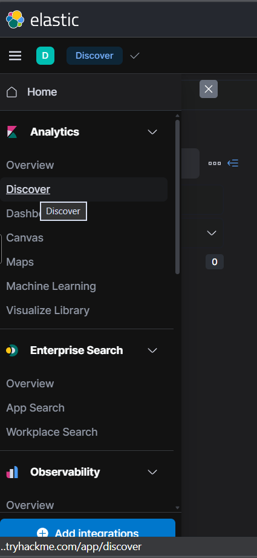

# ItsyBitsy

### Investigating a C2 Incident Using the ELK Stack (Kibana)

## Scenario

During normal SOC monitoring, Analyst **John** observed an alert on an IDS solution indicating potential C2 communication from a user, **Browne**, in the HR department. A suspicious file was accessed containing a malicious pattern in the format `THM{________}`. A week’s worth of HTTP connection logs were pulled to investigate. Due to limited resources, only the connection logs could be pulled, ingested into the `connection_logs` index in Kibana.

---

## Q1: How many events were returned for the month of March 2022?

First, I headed to the hamburger icon and then went to **Discover** to start the investigation.



I then updated the date range using the absolute date option, setting it from **1 March 2022** to **31 March 2022**.


**Answer:** `1,482` events.

---

## Q2: What is the IP associated with the suspected user in the logs?

I started focusing on unusual values like IP addresses, URIs, and similar fields. During the analysis, I noticed a user-agent string named `bitsadmin`.

Using `bitsadmin` in my query, I got **2** events, and from those I also found the source IP:


I also noticed the `host` field showed `pastebin.com` — worth keeping in mind for the upcoming questions.

**Answer:** `192.166.65.54`

---

## Q3: The user’s machine used a legitimate Windows binary to download a file from the C2 server. What is the name of the binary?

For this, I did some searching on Google about “Bits Admin,” and found:

> “BITSAdmin is a command-line tool used to manage Background Intelligent Transfer Service (BITS) jobs in Windows. It allows users to create, download, or upload files in the background, utilizing idle network bandwidth for efficient transfers.”
> 

This means `bitsadmin` is the legitimate Windows binary used to download the file from the C2 server.

**Answer:** `bitsadmin`

---

## Q4: The infected machine connected with a famous file-sharing site, which also acted as a C2 server. What is the name of this site?

Already identified in Q2.

**Answer:** `pastebin.com`

---

## Q5: What is the full URL of the C2 to which the infected host is connected?

In the two logs filtered for `bitsadmin`, I also found a URI field, with the value:

```
/yTg0Ah6a
```

So the full URL becomes:

**Answer:** `pastebin.com/yTg0Ah6a`

---

## Q6: A file was accessed on the file-sharing site. What is the name of the file accessed?

I got this filename by visiting the full URL from the previous question.

**Answer:** `secret.txt`

---

## Q7: The file contains a secret code with the format `THM{_____}`.

In the full pastebin URL, I also found the THM-format secret code:

**Answer:** `THM{SECRET_CODE}`

---

## Summary

| # | Finding |
| --- | --- |
| Total March 2022 events | 1,482 |
| Suspicious source IP | 192.166.65.54 |
| Flagged user-agent | `bitsadmin` |
| Legitimate binary abused for download | `bitsadmin.exe` (BITSAdmin) |
| File-sharing site used as C2 | pastebin.com |
| Full C2 URL | pastebin.com/yTg0Ah6a |
| File accessed on C2 | secret.txt |
| Recovered flag | `THM{SECRET_CODE}` |

**Verdict:** Confirmed C2 communication abusing the legitimate Windows `bitsadmin` utility (a classic LOLBIN technique) to silently download a file from a Pastebin-hosted C2 channel, consistent with the IDS alert and the HR department user’s reported compromise.